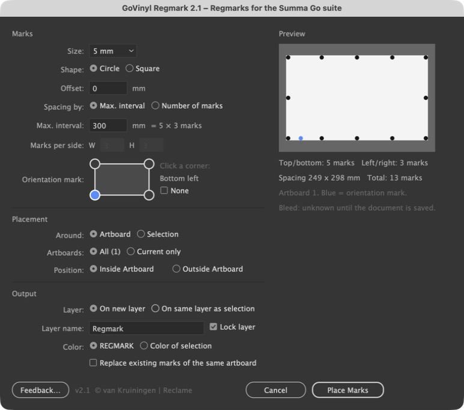

# GoVinyl Regmark

**Regmarks for the Summa Go suite**

An Adobe Illustrator script that places registration marks (regmarks) for **cut-vinyl** work around your artboards or a selection, made for Summa GoSign and GoProduce.

### The workflow
1. **Kiss-cut** the design *and* the regmarks in vinyl on a Summa roll cutter (Summa GoSign).
2. **Weed** the vinyl, but leave the regmarks in place.
3. Put **application tape** over the weeded vinyl.
4. **Thru-cut** the taped vinyl on a Summa F Series flatbed (Summa GoProduce). Its camera reads the cut vinyl regmarks, so the cut lines up exactly with the design. The result: separate pieces of vinyl with application tape, ready to apply.

Because you choose the mark size yourself, you can make the marks large, for example 10 mm. Large marks are much quicker to weed around than the 3 mm squares or 5 mm circles that Summa's own plug-ins place. You also set the offset, the number and spacing of the marks, and the corner of the orientation mark, with a live preview.

*GoVinyl Regmark is an independent project and is not made, endorsed or supported by Summa. Summa, GoSign and GoProduce are names of Summa NV.*

## Why GoVinyl Regmark?
For printed work, registration marks are never a problem: every RIP adds them for you. But a job that is **only cut vinyl** never goes through a RIP, so there is nothing to add the marks. You end up drawing them by hand.

I built this script for one reason: the Illustrator plug-ins Summa supplies for GoSign and GoProduce were too limited for this work. They place small marks with fixed settings (3 mm squares or 5 mm circles), which are slow to weed in vinyl, and you cannot change their size, spacing or number. The first version came together in a few evenings in 2025, worked well from the start, and has saved our shop a lot of time ever since. Version 2 adds everything we missed: free spacing or a fixed number of marks, a corner of your choice for the orientation mark, a live preview with the document bleed, and settings that are remembered.

GoVinyl Regmark is already in daily use at several sign shops besides ours. Their experiences led to a number of the changes and additions in version 2. We share it because other sign makers run into the same gap.

## Installation
1. Download `GoVinyl_Regmark_v….js` from the latest [release](https://github.com/vankruiningen/govinyl-regmark/releases/latest). The version number is in the file name and in the window title, so you can always tell which copy you are running. Remove older copies from Illustrator's Scripts folder.
2. In Illustrator, go to **File > Scripts > Other Script...** and select the file.

### In the menu, with a keyboard shortcut
To start GoVinyl Regmark from the menu, or with a single key:

1. **Put the script in Illustrator's Scripts folder** (for example `GoVinyl_Regmark_v2.0.js`):
   - macOS: `/Applications/Adobe Illustrator 2026/Presets.localized/en_US/Scripts/`
   - Windows: `C:\Program Files\Adobe\Adobe Illustrator 2026\Presets\en_US\Scripts\`

   Use your own Illustrator version and language folder. Remove older copies from this folder, then restart Illustrator. The script is now under **File > Scripts > GoVinyl_Regmark_v2.0**.
2. **Create an action for it:** open **Window > Actions**, click *Create New Set* (folder icon) and name it `GoVinyl`. Click *Create New Action* (plus icon), name it `GoVinyl Regmark`, choose a **Function Key** (for example F5) and click **Record**.
3. In the Actions panel menu (☰), choose **Insert Menu Item...**, then choose **File > Scripts > GoVinyl_Regmark_v2.0** from Illustrator's menu bar and click **OK**.
4. Click **Stop** (square button) in the Actions panel.

Press F5 to open GoVinyl Regmark. On a Mac keyboard you may need to hold **fn** for function keys.

**Updating:** put the new version in the Scripts folder, remove the old one and restart Illustrator. Because the file name contains the version, the action still points to the old menu item: in the Actions panel, double-click the *Insert Menu Item* step of your action and choose the new **File > Scripts > GoVinyl_Regmark_v…** item. The shortcut stays the same.

**Tested with:** Adobe Illustrator 2026 on macOS, Summa GoSign for kiss-cutting on a Summa roll cutter, and Summa GoProduce for thru-cutting on a Summa F Series. It has not been tested on Windows, with older Illustrator versions or with other cutting software; reports are very welcome.

## Usage
1. Open a document in Illustrator.
2. Optionally select artwork (needed for *Selection*, *Layer: As selection* and *Color of selection*).
3. Run the script, choose your settings and click **Place Marks**.

### Marks
- **Size:** 3, 5 or 10 mm, or your own size via *Custom*.
- **Shape:** circle or square.
- **Offset:** distance between the edge of the artboard (or selection) and the edge of the mark (default 5 mm). At 0 mm the mark touches the edge, fully inside or fully outside depending on *Position*; at minus half the mark size its centre sits on the edge. A negative offset moves the marks past the edge: with *Inside Artboard* and an offset of -10 mm, the marks end up just outside the artwork.
- **Spacing by:** choose how the marks along the edges are spread:
  - *Max. interval:* the maximum distance between two marks (default 600 mm). Longer sides get evenly spaced intermediate marks. Next to the field you see how many marks that gives, e.g. `= 5 × 5 marks` (width × height).
  - *Number of marks:* a fixed number of marks per side, corners included: **W** for the top and bottom edge, **H** for the left and right edge (minimum 2 = corners only). Next to the fields you see the resulting spacing, e.g. `= 296 × 296 mm`.
  - When you switch, the current result is carried over: the counts that the interval gives, or the interval that keeps those counts.
  - With *All artboards*, *Number of marks* gives every artboard the same number of marks; *Max. interval* gives every artboard the same maximum spacing.
- **Orientation mark:** an extra mark that shows the feed direction. Click the corner you want in the small corner picker; the mark is placed next to that corner mark on the horizontal edge, towards the middle, in the same shape (circle or square) as the other marks. The clear gap between the two is twice the mark size (10 mm marks: 20 mm gap, edge to edge). Tick **None** to leave it out.

Numbers may use a dot or a comma (`5.5` or `5,5`).

### Placement
- **Around:** the artboard or the current selection.
- **Artboards:** all artboards or the current one only.
- **Position:** *Inside Artboard* or *Outside Artboard* (with *Selection*: *Inside Selection* or *Outside Selection*). Remembered separately for artboard and selection (default: artboard inside, selection outside).

For a selection with a clipping mask only the mask counts, not the hidden content.

### Output
- **Layer:**
  - *New Layer* puts the marks on a separate layer with the given **layer name** (default `Regmark`, the layer name Summa GoSign and GoProduce use for registration marks). If a layer with that name already exists it is reused. Tick **Lock layer** to lock it straight after the marks are placed.
  - *As selection* puts the marks on the layer of the first selected object. That layer is not locked.
- **Color:**
  - *REGMARK* uses the spot color `REGMARK` at 100%. It is created (as black) if the document does not have it yet.
  - *Color of selection* uses the first solid fill color found in the selection, or the stroke color if there is no fill.
- **Replace existing marks of the same artboard:** running the script again replaces the marks of that artboard on the chosen layer instead of stacking them. Marks around a selection are never removed automatically.

Marks are grouped per target: `Regmarks - Artboard 1`, `Regmarks - Selection`, and so on.

### Preview
The right side of the dialog shows a live preview of the current artboard (or the selection) with the marks as they will be placed. It updates while you type or click. Below it you see how many marks come on the top/bottom and left/right edges, the actual spacing between them and the total. The orientation mark is shown in blue, and the document bleed in red, so you can see whether the marks land in the bleed. Illustrator does not give scripts access to the bleed, so it is read from the saved `.ai` file: save the document first (with *Create PDF Compatible File* on, the default). After changing the bleed, save again to update the preview. With *All artboards* the preview shows the current artboard; the others get the same layout for their own size.

## Messages
- If an artboard is too small for the chosen size and offset, that artboard is skipped and reported.
- If the marks would touch each other, nothing is placed and the preview says so.
- If the orientation mark does not fit next to the chosen corner mark, it is left out and reported.

## Other features
- **Remembers settings:** your last used settings are stored in `GoVinyl/settings.json` in your user application-data folder. Settings from earlier versions are taken over once. Settings are saved when you click **Place Marks**, not on **Cancel**.
- **Large Canvas:** works on large canvases by taking Illustrator's scale factor into account.

## Ideas for the future
- **Quick sets:** save a combination of settings under a name (for example per material, mark size or customer) and recall it with one click. This is being considered for a future version; if you would use it, tell us how in an [issue](https://github.com/vankruiningen/govinyl-regmark/issues/new/choose).

## Feedback and contributing
Something not working, or an idea? [Open an issue](https://github.com/vankruiningen/govinyl-regmark/issues/new/choose); the **Feedback** button in the dialog takes you there too. After 10 uses the script asks once whether you would like to give feedback.

Want to change something yourself? See [CONTRIBUTING.md](CONTRIBUTING.md). Changes per version are in [CHANGELOG.md](CHANGELOG.md).

## License
Copyright (C) 2025-2026 Niels - van Kruiningen | Reclame.

This script is free software, released under the [GNU General Public License v3.0](LICENSE). You may use, share and change it; if you distribute a changed version, you must share its source code under the same license.
